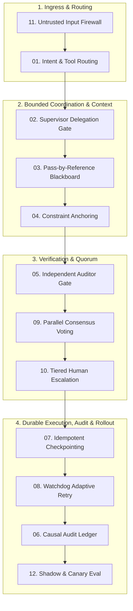

# Agentic Production Skills

[](https://github.com/DevDizzle/agentic-production-skills/actions/workflows/ci.yml)
[](./LICENSE)
[](./pyproject.toml)
[](./tsconfig.json)
[](./package.json)

Twelve installable AI coding skills (`SKILL.md`) paired with zero-dependency, strictly typed reference implementations in **Python 3.11+** and **TypeScript** for shipping reliable, auditable, and resilient AI agent systems in production.

Most agent failures in production are not model IQ failures: they are systems engineering failures. Unbounded delegation loops, quadratic context bloat, prompt-injected tool calls, duplicate crash-recovery writes, approval fatigue, and unverified prompt rollouts break otherwise capable agents. This repository packages concrete architectural guardrails so coding agents (and human engineers) apply disciplined distributed-systems patterns from day one.

---

## Architecture Map



### The 12 Production Skills

| # | Skill | Domain | Primary Reference Classes | Production Failure Prevented |
| :- | :--- | :--- | :--- | :--- |
| 01 | [`intent-and-tool-routing`](./skills/intent-and-tool-routing/SKILL.md) | Coordination | `IntentRouter`, `ScopedToolRegistry` | Tool-schema token bloat, low-confidence misrouting, out-of-scope tool calls |
| 02 | [`supervisor-delegation-gate`](./skills/supervisor-delegation-gate/SKILL.md) | Coordination | `SupervisorGate`, `DelegationPolicy` | `A -> B -> A` ping-pong loops, unbounded fan-out depth, runaway token spend |
| 03 | [`pass-by-reference-blackboard`](./skills/pass-by-reference-blackboard/SKILL.md) | Coordination | `PassByRefBlackboard`, `ArtifactPointer` | Quadratic prompt history growth and LLM JSON re-serialization corruption |
| 04 | [`constraint-anchoring`](./skills/constraint-anchoring/SKILL.md) | Governance | `ConstraintEnvelope`, `Invariant` | Long-horizon instruction drift and context-compaction rule amnesia |
| 05 | [`independent-auditor-gate`](./skills/independent-auditor-gate/SKILL.md) | Governance | `IndependentAuditorGate`, `strip_reasoning_trace` | Sycophantic self-critique anchored on biased generator chain-of-thought |
| 06 | [`causal-audit-ledger`](./skills/causal-audit-ledger/SKILL.md) | Governance | `CausalAuditLedger`, `LedgerEntry` | Unverifiable async logs lacking causal parent lineage or tamper evidence |
| 07 | [`idempotent-checkpointing`](./skills/idempotent-checkpointing/SKILL.md) | Resilience | `IdempotentCheckpointer` | Duplicate payments, emails, or database writes on crash-recovery replay |
| 08 | [`watchdog-adaptive-retry`](./skills/watchdog-adaptive-retry/SKILL.md) | Resilience | `WatchdogRetryRunner`, `RetryPolicy` | Blind retries on validation errors, hung tool calls, cascading outages |
| 09 | [`parallel-consensus-voting`](./skills/parallel-consensus-voting/SKILL.md) | Resilience | `ParallelConsensus`, `VoterSpec` | Single-sample stochastic classification variance and unhandled vote ties |
| 10 | [`tiered-human-escalation`](./skills/tiered-human-escalation/SKILL.md) | Resilience | `TieredEscalationGate`, `ApprovalTicket` | Operator approval fatigue, self-approval loopholes, stale zombie tickets |
| 11 | [`untrusted-input-firewall`](./skills/untrusted-input-firewall/SKILL.md) | Security | `UntrustedInputFirewall`, `TaintedContent` | Indirect prompt injection, stealth Unicode smuggling, tainted tool hijacks |
| 12 | [`shadow-canary-eval`](./skills/shadow-canary-eval/SKILL.md) | Release | `ShadowCanaryRunner`, `PromotionPolicy` | Silent prompt/model regressions and unisolated candidate errors in live traffic |

---

## Maturity Tiers: Adopt Incrementally

Do not bolt all 12 patterns onto an MVP on day one. Adopt them by operational risk tier:

### Tier 1: Single-Agent Production Foundation (Start Here)
Apply before exposing any tool-calling agent to external users or untrusted data:
- **`untrusted-input-firewall`**: Sanitize, spotlight, and taint-track RAG chunks, emails, and webhooks.
- **`intent-and-tool-routing`**: Scope prompt manifests and enforce runtime tool permissions per intent.
- **`watchdog-adaptive-retry`**: Enforce per-call deadlines, error-class adaptive repair, and circuit breaking.

### Tier 2: State-Mutating & Regulated Workflows
Apply as soon as an agent writes to databases, moves money, modifies infrastructure, or messages customers:
- **`idempotent-checkpointing`**: Guarantee at-most-once execution across worker crashes and retries.
- **`tiered-human-escalation`**: Route actions across `AUTO_EXECUTE`, `ASYNC_AUDIT`, `EXPLICIT_APPROVAL`, and `DUAL_CONTROL_BLOCK`.
- **`constraint-anchoring`**: Pin fingerprinted safety invariants across multi-turn compaction boundaries.
- **`independent-auditor-gate`**: Verify high-impact SQL, code, or external communications in a stripped context.
- **`causal-audit-ledger`**: Record hash-chained causal DAG lineage for every mutation and policy check.

### Tier 3: Scale, High-Stakes Quorum & Multi-Agent Topologies
Apply when scale, domain separation, or continuous model upgrades demand it:
- **`supervisor-delegation-gate`**: Enforce cycle detection, transition allowlists, and hard delegation budgets.
- **`pass-by-reference-blackboard`**: Keep multi-kilobyte payloads out of conversation context via verified handles.
- **`parallel-consensus-voting`**: Aggregate confidence-weighted multi-voter quorums on critical classifications.
- **`shadow-canary-eval`**: Gate prompt and model migrations on live shadow parity and auto-rollback canaries.

---

## When NOT to Use Multi-Agent Architectures

Before reaching for multi-agent supervisors, consensus quorums, or blackboards, verify that a simpler architecture does not solve the problem better:

1. **Deterministic Control Flow Known Up Front:** If your workflow is always `fetch_invoice -> extract_line_items -> validate_totals -> write_row`, write a plain Python or TypeScript function pipeline. Wrapping deterministic code in a dynamic multi-agent supervisor adds 3x to 8x latency, unpredictable failure modes, and extra token cost for zero benefit.
2. **Single Cohesive Domain (< 8 Tools, < 20K Context):** A single well-prompted tool-calling loop with [`intent-and-tool-routing`](./skills/intent-and-tool-routing/SKILL.md) and [`watchdog-adaptive-retry`](./skills/watchdog-adaptive-retry/SKILL.md) consistently outperforms a 4-agent team that loses nuance across handoff boundaries.
3. **Deterministic Verification Exists:** Never pay for [`independent-auditor-gate`](./skills/independent-auditor-gate/SKILL.md) or [`parallel-consensus-voting`](./skills/parallel-consensus-voting/SKILL.md) when a compiler (`tsc --noEmit`), AST parser, SQL `EXPLAIN`, or JSON Schema validator can verify correctness deterministically in 2 milliseconds.
4. **Split Multi-Agent Only on Real Boundaries:** Introduce separate subagents only when tasks require **distinct security credentials**, **incompatible tool scopes**, **separate context windows for noisy intermediate search**, or **independent verification isolation**.

---

## Installation for AI Coding Agents

Every skill in [`skills/`](./skills) follows the open `SKILL.md` progressive-disclosure format (`name` + `description` YAML frontmatter) and works across modern AI coding assistants.

### Google Antigravity (`agy`)

Clone into your global Antigravity plugins directory (loads all 12 skills as a single toggleable bundle via [`plugin.json`](./plugin.json)) or into a project workspace:

```bash
# Global plugin installation
git clone https://github.com/DevDizzle/agentic-production-skills.git \
  ~/.gemini/config/plugins/agentic-production-skills

# Or workspace-scoped skills installation
mkdir -p .agents/skills
cp -r agentic-production-skills/skills/* .agents/skills/
```

### Claude Code

Copy the skills into your personal (`~/.claude/skills/`) or repository (`.claude/skills/`) skills directory:

```bash
git clone https://github.com/DevDizzle/agentic-production-skills.git /tmp/agentic-production-skills

# Personal skills (available across all repos)
mkdir -p ~/.claude/skills
cp -r /tmp/agentic-production-skills/skills/* ~/.claude/skills/

# Or project-scoped skills (checked into git for your team)
mkdir -p .claude/skills
cp -r /tmp/agentic-production-skills/skills/* .claude/skills/
```

### Cursor

Copy into `.cursor/skills/` (or `.agents/skills/`) inside your project workspace so Cursor's agent automatically discovers each skill description on demand:

```bash
mkdir -p .cursor/skills
cp -r /path/to/agentic-production-skills/skills/* .cursor/skills/
```

### OpenAI Codex CLI

Install into `$CODEX_HOME/skills` (defaults to `~/.codex/skills`) or workspace `.agents/skills/`:

```bash
mkdir -p ~/.codex/skills
cp -r /path/to/agentic-production-skills/skills/* ~/.codex/skills/
```

---

## Using the Reference Libraries

Both reference implementations use **zero external runtime dependencies** and rely exclusively on the Python 3.11+ standard library and pure ES2023 TypeScript.

### Python Usage

```bash
# Install locally in editable mode (or add python/ to PYTHONPATH)
pip install -e .
```

```python
from agentic_patterns import (
    ActionProposal,
    CausalAuditLedger,
    IdempotentCheckpointer,
    Reversibility,
    TieredEscalationGate,
    UntrustedInputFirewall,
)

# 1. Inspect and spotlight untrusted RAG content
firewall = UntrustedInputFirewall(privileged_tools={"issue_refund"})
doc = firewall.inspect_and_spotlight("Order ORD-42 arrived damaged.", source="ticket:42")

# 2. Evaluate risk tier before executing a mutation
escalation = TieredEscalationGate()
decision = escalation.evaluate(
    ActionProposal(
        proposal_id="p-42",
        proposer="support_agent",
        action_name="Refund damaged item",
        reversibility=Reversibility.REVERSIBLE,
        monetary_impact=24.00,
        confidence=0.94,
    )
)

# 3. Execute at-most-once and record causal audit lineage
if decision.can_execute_now:
    checkpointer = IdempotentCheckpointer()
    tx = checkpointer.execute_once(
        workflow_id="wf-ticket-42",
        step_name="issue_refund",
        args={"order_id": "ORD-42", "cents": 2400},
        action=lambda: {"refund_id": "re_1042"},
    )
    ledger = CausalAuditLedger()
    e_doc = ledger.append(actor="rag", event_type="ticket_ingested", payload={"src": doc.source})
    ledger.append(
        actor="support_agent",
        event_type="refund_executed",
        parent_ids=(e_doc.entry_id,),
        payload=tx.output,
    )
```

### TypeScript Usage

Works natively in Node.js (`>=22.6` / v26 native TypeScript), Deno, Bun, Cloudflare Workers, and Vercel Edge Runtime:

```typescript
import {
  CausalAuditLedger,
  IdempotentCheckpointer,
  TieredEscalationGate,
  UntrustedInputFirewall,
} from "./typescript/src/index.ts";

const firewall = new UntrustedInputFirewall({ privilegedTools: ["issue_refund"] });
const doc = firewall.inspectAndSpotlight("Order ORD-42 arrived damaged.", "ticket:42");

const escalation = new TieredEscalationGate();
const decision = escalation.evaluate({
  proposalId: "p-42",
  proposer: "support_agent",
  actionName: "Refund damaged item",
  reversibility: "REVERSIBLE",
  monetaryImpact: 24.0,
  confidence: 0.94,
});

if (decision.canExecuteNow) {
  const checkpointer = new IdempotentCheckpointer();
  const tx = checkpointer.executeOnce({
    workflowId: "wf-ticket-42",
    stepName: "issue_refund",
    args: { orderId: "ORD-42", cents: 2400 },
    action: () => ({ refundId: "re_1042" }),
  });

  const ledger = new CausalAuditLedger();
  const eDoc = ledger.append({
    actor: "rag",
    eventType: "ticket_ingested",
    payload: { src: doc.source },
  });
  ledger.append({
    actor: "support_agent",
    eventType: "refund_executed",
    parentIds: [eDoc.entryId],
    payload: tx.output,
  });
}
```

---

## Running Tests & Typechecking

```bash
# 1. Python 3.11+ unit test suite
PYTHONPATH=python python3 -m unittest discover -s tests/python -v

# 2. Native Node TypeScript test suite
node --test tests/typescript/patterns.test.ts

# 3. Strict TypeScript compiler check (strict: true, noImplicitAny: true, zero any)
npm run typecheck
```

---

## Repository Layout

```text
agentic-production-skills/
├── README.md
├── LICENSE
├── plugin.json
├── pyproject.toml
├── package.json
├── tsconfig.json
├── skills/                            # 12 installable SKILL.md definitions
│   ├── intent-and-tool-routing/SKILL.md
│   ├── supervisor-delegation-gate/SKILL.md
│   ├── pass-by-reference-blackboard/SKILL.md
│   ├── constraint-anchoring/SKILL.md
│   ├── independent-auditor-gate/SKILL.md
│   ├── causal-audit-ledger/SKILL.md
│   ├── idempotent-checkpointing/SKILL.md
│   ├── watchdog-adaptive-retry/SKILL.md
│   ├── parallel-consensus-voting/SKILL.md
│   ├── tiered-human-escalation/SKILL.md
│   ├── untrusted-input-firewall/SKILL.md
│   └── shadow-canary-eval/SKILL.md
├── python/agentic_patterns/           # Zero-dependency Python 3.11+ implementation
│   ├── __init__.py
│   ├── coordination.py
│   ├── compliance.py
│   └── resilience.py
├── typescript/src/                    # Zero-dependency strict TypeScript implementation
│   ├── index.ts
│   ├── coordination.ts
│   ├── compliance.ts
│   └── resilience.ts
└── tests/
    ├── python/test_patterns.py
    └── typescript/patterns.test.ts
```

---

## Author & License

Created by **Evan Parra** ([evanparra.ai](https://evanparra.ai) | [@DevDizzle](https://github.com/DevDizzle)).

Released under the [MIT License](./LICENSE).
