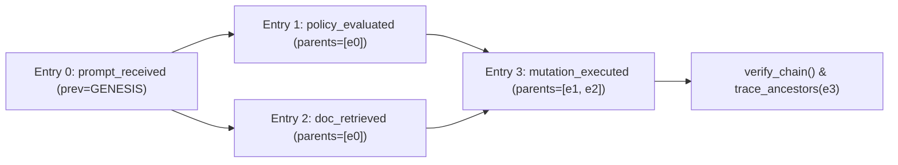

# Causal Audit Ledger

## 1. Problem & Failure Mode

Conventional unstructured application logs fail forensic and regulatory audits of autonomous systems for three reasons:

1. **Lost Causal Lineage in Async Runs:** When three parallel subagents emit interleaved log lines, timestamp order alone cannot prove *which* retrieved document, policy decision, or human approval caused a specific database write or refund.
2. **Mutable Log Tampering:** Standard log tables or JSON files allow silent row deletion, payload edits, or sequence reordering after an incident without cryptographic detection.
3. **Raw PII Sprawl in Audit Headers:** Dumping full customer records into plain-text logs creates a secondary compliance liability, whereas storing canonical SHA-256 `payload_digest` commitments proves exact payload integrity without duplicating raw secrets everywhere.

## 2. When to Use vs. When NOT to Use

### Use When
- Agents execute external mutations (payments, account changes, code deployments, ticket updates, external messages).
- Regulated environments (SOC 2, HIPAA, FINRA, FedRAMP) or internal security teams require verifiable "why did the agent do X?" lineage and tamper detection.
- Parallel tool calls or multi-agent fan-out require a causal DAG (`parent_ids`) rather than a flat chronological log.

### Do NOT Use When
- High-frequency token-streaming telemetry or debug metrics (for example, logging individual SSE chunks): send high-volume ephemeral metrics to OpenTelemetry / Prometheus and reserve the causal ledger for discrete decisions, policy gates, and side effects.
- Purely stateless, read-only local developer utilities with no external state changes.

## 3. Control Flow (Mermaid Diagram)



## 4. Implementation Contract (Python & TypeScript)

Reference implementations live in [`python/agentic_patterns/compliance.py`](../../python/agentic_patterns/compliance.py) and [`typescript/src/compliance.ts`](../../typescript/src/compliance.ts).

### Python Reference Usage

```python
from agentic_patterns.compliance import CausalAuditLedger

ledger = CausalAuditLedger()

e_prompt = ledger.append(
    entry_id="evt-prompt",
    actor="operator",
    event_type="request_received",
    payload={"order_id": "ORD-402", "action": "refund"},
)

e_gate = ledger.append(
    entry_id="evt-gate",
    actor="escalation_gate",
    event_type="auto_approved",
    parent_ids=(e_prompt.entry_id,),
    payload={"tier": "AUTO_EXECUTE", "amount_usd": 19.99},
)

e_exec = ledger.append(
    entry_id="evt-exec",
    actor="billing_agent",
    event_type="refund_committed",
    parent_ids=(e_prompt.entry_id, e_gate.entry_id),
    payload={"order_id": "ORD-402", "stripe_refund_id": "re_991"},
)

assert ledger.verify_chain().valid
lineage = ledger.trace_ancestors(e_exec.entry_id)
```

### TypeScript Reference Usage

```typescript
import { CausalAuditLedger } from "../../typescript/src/compliance.ts";

const ledger = new CausalAuditLedger();

const ePrompt = ledger.append({
  entryId: "evt-prompt",
  actor: "operator",
  eventType: "request_received",
  payload: { orderId: "ORD-402", action: "refund" },
});

const eGate = ledger.append({
  entryId: "evt-gate",
  actor: "escalation_gate",
  eventType: "auto_approved",
  parentIds: [ePrompt.entryId],
  payload: { tier: "AUTO_EXECUTE", amountUsd: 19.99 },
});

const eExec = ledger.append({
  entryId: "evt-exec",
  actor: "billing_agent",
  eventType: "refund_committed",
  parentIds: [ePrompt.entryId, eGate.entryId],
  payload: { orderId: "ORD-402", refundId: "re_991" },
});

const check = ledger.verifyChain();
const ancestors = ledger.traceAncestors(eExec.entryId);
```

### Framework Wiring Guidance
- **Google ADK:** Hook `before_tool_callback`, `after_tool_callback`, and human-approval callbacks to `ledger.append()`, propagating the current turn's `entry_id` in `session.state["last_causal_id"]`.
- **LangGraph:** Persist `LedgerEntry` records in an append-only Postgres table (with `UPDATE`/`DELETE` revoked on the application DB role) alongside node transitions, passing `parent_ids` via graph state.
- **Vercel AI SDK:** Record an entry in `onStepFinish` and inside mutating tool `execute` wrappers, linking tool side effects back to both the user message entry and any policy gate entry.
- **Raw SDK Loops:** Periodically anchor the latest `entry_hash` to external immutable storage (for example, WORM object storage or KMS-signed daily checkpoints) for strong external tamper evidence.

## 5. Production Verification Checklist

When applying this skill to a codebase, write automated tests verifying:
- [ ] **Genesis & Sequential Hash Linkage:** Entry 0 binds `prev_hash == "0" * 64`, and every entry `i > 0` binds `prev_hash == entries[i - 1].entry_hash`.
- [ ] **Causal Parent Existence:** Referencing an unknown or future `parent_id` raises `LedgerIntegrityError` at append time.
- [ ] **Tamper Detection:** Modifying any field (`actor`, `metadata`, `parent_ids`, `prev_hash`) on any historical entry causes `verify_chain()` to return `valid=False` with exact `broken_at_seq`.
- [ ] **Payload Commitment:** `verify_payload(entry_id, payload)` returns `True` across key-reordered JSON equivalents and `False` if any value changes.
- [ ] **Ancestor Reconstruction:** `trace_ancestors(entry_id)` returns all transitive upstream causes sorted in chronological sequence order without duplicates.
