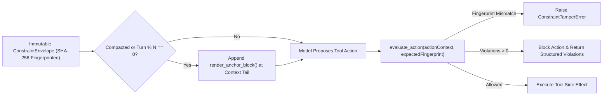

# Constraint Anchoring

## 1. Problem & Failure Mode

Placing safety and business constraints only in the initial system prompt fails on long-horizon tasks for three structural reasons:

1. **Middle-of-Context Attention Decay:** After 15 tool-calling turns filled with verbose logs and user follow-ups, initial system instructions sit tens of thousands of tokens behind recent context and lose salience during action generation.
2. **Summarization and Compaction Amnesia:** Context-compaction routines summarize prior conversation history into prose, inadvertently paraphrasing away hard numeric limits or dropping negative constraints ("never touch table X").
3. **Prompt-Only Enforcement:** Relying solely on the model to remember a spend limit or SQL restriction provides zero deterministic guarantee right before a side-effecting tool executes.

## 2. When to Use vs. When NOT to Use

### Use When
- Agent sessions exceed 5 to 8 turns or use automatic context summarization / sliding windows.
- Hard invariants exist (spend caps, read-only database rules, allowed tenant IDs, prohibited shell flags) that must hold on turn 40 with the exact same rigor as turn 1.
- You want both recency-positioned prompt reminders (`render_anchor_block`) and deterministic pre-execution code gates (`evaluate_action`) driven from a single source of truth.

### Do NOT Use When
- The interaction is a single-shot stateless extraction or classification call with no tool execution: standard schema validation on the single output is sufficient.
- The "constraint" is a soft stylistic preference (tone, formatting) rather than an operational invariant.

## 3. Control Flow (Mermaid Diagram)



## 4. Implementation Contract (Python & TypeScript)

Reference implementations live in [`python/agentic_patterns/compliance.py`](../../python/agentic_patterns/compliance.py) and [`typescript/src/compliance.ts`](../../typescript/src/compliance.ts).

### Python Reference Usage

```python
from agentic_patterns.compliance import ConstraintEnvelope, Invariant

envelope = ConstraintEnvelope(
    envelope_id="treasury-prod-v1",
    invariants=(
        Invariant(
            rule_id="max_wire_usd",
            statement="Never execute a transfer above 10000 USD.",
            severity="CRITICAL",
            validator=lambda ctx: (
                float(ctx.get("amount_usd", 0.0)) <= 10_000.0,
                f"amount_usd={ctx.get('amount_usd')} exceeds 10000",
            ),
        ),
        Invariant(
            rule_id="no_destructive_sql",
            statement="Never run DROP or TRUNCATE statements.",
            severity="CRITICAL",
            validator=lambda ctx: (
                "drop " not in str(ctx.get("sql", "")).lower(),
                "Destructive DDL statement detected",
            ),
        ),
    ),
)

pinned_hash = envelope.fingerprint

# Re-pin near context tail every 4 turns or right after context compaction
if envelope.should_reanchor(turn_index=8, every_n_turns=4, compacted=False):
    anchor_reminder = envelope.render_anchor_block(turn_index=8)

# Deterministic pre-execution gate
check = envelope.evaluate_action(
    {"amount_usd": 2500, "sql": "SELECT id FROM ledger LIMIT 10"},
    expected_fingerprint=pinned_hash,
)
assert check.allowed
```

### TypeScript Reference Usage

```typescript
import { ConstraintEnvelope } from "../../typescript/src/compliance.ts";

interface ActionCtx {
  readonly amountUsd: number;
  readonly sql: string;
}

const envelope = new ConstraintEnvelope<ActionCtx>({
  envelopeId: "treasury-prod-v1",
  invariants: [
    {
      ruleId: "max_wire_usd",
      severity: "CRITICAL",
      statement: "Never execute a transfer above 10000 USD.",
      validator: (ctx) => ({
        passed: ctx.amountUsd <= 10_000,
        detail: `amountUsd=${ctx.amountUsd} exceeds 10000`,
      }),
    },
  ],
});

if (ConstraintEnvelope.shouldReanchor({ turnIndex: 8, everyNTurns: 4 })) {
  const anchorBlock = envelope.renderAnchorBlock(8);
}

const result = envelope.evaluateAction(
  { amountUsd: 2500, sql: "SELECT 1" },
  envelope.fingerprint,
);
```

### Framework Wiring Guidance
- **Google ADK:** Inject `render_anchor_block()` inside `before_model_callback` when turn count or compaction triggers fire, and enforce `evaluate_action()` inside `before_tool_callback`.
- **LangGraph:** Store `envelope_fingerprint` in immutable graph config (`RunnableConfig`), append the anchor block in your prompt-assembly node after `SummarizationNode`, and gate tool nodes with `evaluate_action()`.
- **Vercel AI SDK:** Use `prepareStep` in multi-step `generateText` loops to append `render_anchor_block()` on periodic steps, and run `evaluate_action()` at the top of each mutating tool's `execute` handler.
- **Raw SDK Loops:** Never allow context-pruning logic to touch the `ConstraintEnvelope` object; re-inject `render_anchor_block()` as the final system reminder right before high-step inference calls.

## 5. Production Verification Checklist

When applying this skill to a codebase, write automated tests verifying:
- [ ] **Deterministic Fingerprint:** Identical invariants passed in different list orders produce the exact same SHA-256 `fingerprint`.
- [ ] **Tamper Rejection:** Calling `verify_fingerprint()` or `evaluate_action()` with a stale or altered hash raises `ConstraintTamperError`.
- [ ] **Compaction & Cadence Trigger:** `should_reanchor()` returns `True` immediately whenever `compacted=True` and on exact multiples of `every_n_turns`.
- [ ] **Multi-Violation Reporting:** An action violating multiple invariants returns `allowed=False` and lists every violated `rule_id` in `violations` rather than masking secondary failures.
