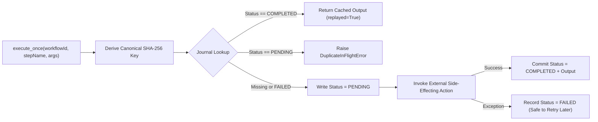

# Idempotent Checkpointing

## 1. Problem & Failure Mode

Long-running agent loops frequently crash or time out after partially mutating external state:

1. **Duplicate Side Effects on Resume:** Step 1 charges a customer card or posts a Slack incident alert, Step 2 hits a model rate limit, and restarting the workflow from Step 1 executes Step 1's external mutation a second time.
2. **Non-Canonical Key Drift:** Deriving idempotency keys from raw JSON strings without canonical key sorting (`{"a":1,"b":2}` vs. `{"b":2,"a":1}`) misses the journal cache on retry and triggers duplicate writes.
3. **Concurrent Split-Brain Replay:** Two queue workers pick up the same stalled `workflow_id` simultaneously and execute the same uncommitted step in parallel because no `PENDING` in-flight lock exists.

## 2. When to Use vs. When NOT to Use

### Use When
- Workflows span multiple steps where at least one tool mutates external state (payments, webhooks, CRM updates, provisioning, outbound notifications).
- Agent runs can be retried by background job queues, durable execution engines, or human "retry run" buttons.

### Do NOT Use When
- Every tool in the workflow is strictly read-only and cheap: standard HTTP/query caching suffices without workflow journaling.
- You already run each external mutation inside an atomic single-statement ACID database transaction with native `ON CONFLICT DO NOTHING` and zero multi-step orchestration.

## 3. Control Flow (Mermaid Diagram)



## 4. Implementation Contract (Python & TypeScript)

Reference implementations live in [`python/agentic_patterns/resilience.py`](../../python/agentic_patterns/resilience.py) and [`typescript/src/resilience.ts`](../../typescript/src/resilience.ts).

### Python Reference Usage

```python
from agentic_patterns.resilience import IdempotentCheckpointer

checkpointer = IdempotentCheckpointer()

# First execution runs the external side effect and journals the output
first = checkpointer.execute_once(
    workflow_id="wf-order-882",
    step_name="capture_payment",
    args={"order_id": "ORD-882", "amount_cents": 4900},
    action=lambda: {"provider_tx": "ch_99201", "captured": True},
)
assert not first.replayed

checkpointer.save_checkpoint(
    workflow_id="wf-order-882",
    cursor="payment_captured",
    state={"tx": first.output["provider_tx"]},
)

# Crash-recovery replay skips the external call and returns cached output
second = checkpointer.execute_once(
    workflow_id="wf-order-882",
    step_name="capture_payment",
    args={"amount_cents": 4900, "order_id": "ORD-882"},
    action=lambda: (_ for _ in ()).throw(AssertionError("Must not re-run")),
)
assert second.replayed
```

### TypeScript Reference Usage

```typescript
import { IdempotentCheckpointer } from "../../typescript/src/resilience.ts";

const checkpointer = new IdempotentCheckpointer();

const first = checkpointer.executeOnce({
  workflowId: "wf-order-882",
  stepName: "capture_payment",
  args: { orderId: "ORD-882", amountCents: 4900 },
  action: () => ({ providerTx: "ch_99201", captured: true }),
});

checkpointer.saveCheckpoint({
  workflowId: "wf-order-882",
  cursor: "payment_captured",
  state: { tx: first.output.providerTx },
});

const replay = checkpointer.executeOnce({
  workflowId: "wf-order-882",
  stepName: "capture_payment",
  args: { amountCents: 4900, orderId: "ORD-882" },
  action: () => {
    throw new Error("Must not re-execute committed side effect");
  },
});
```

### Framework Wiring Guidance
- **Google ADK:** Wrap mutating `FunctionTool` handlers with `checkpointer.execute_once()`, keying `workflow_id` on ADK `ToolContext.invocation_id` or a business correlation ID, and pass `idempotency_key` downstream in HTTP `Idempotency-Key` headers (for example, Stripe or Adyen).
- **LangGraph:** Note that LangGraph's built-in `Checkpointer` snapshots *node boundaries*, meaning if a node runs two side effects and fails on the second, LangGraph re-runs the entire node on resume! Always wrap individual side-effecting calls inside LangGraph nodes with `IdempotentCheckpointer.execute_once()`.
- **Vercel AI SDK:** Key `workflowId` on the client's deterministic request/message ID inside mutating `tool.execute` handlers backed by Redis (`SET key PENDING NX EX 300`) or Postgres.
- **Raw SDK Loops:** Forward the derived `idempotency_key` to downstream REST/gRPC APIs that support server-side idempotency keys so network drops between response commit and client receipt remain safe.

## 5. Production Verification Checklist

When applying this skill to a codebase, write automated tests verifying:
- [ ] **Canonical Key Stability:** Reordered dictionary/object keys (`{"a": 1, "b": 2}` vs. `{"b": 2, "a": 1}`) produce the exact same `idempotency_key`.
- [ ] **At-Most-Once Replay:** Re-invoking `execute_once()` after `COMPLETED` returns `replayed=True` and executes the underlying `action` callback zero additional times.
- [ ] **Recovery After Transient Failure:** When `action` raises an exception on attempt 1, status transitions to `FAILED` (not `COMPLETED`), allowing attempt 2 to execute cleanly.
- [ ] **Concurrent In-Flight Lock:** A concurrent or re-entrant `execute_once()` call for a `PENDING` key raises `DuplicateInFlightError`.
- [ ] **Output Immutability:** Mutating the returned `output` dictionary in caller code does not corrupt the cached output returned on subsequent replays.
