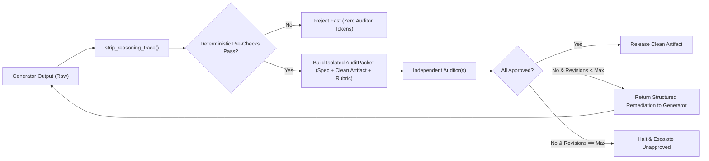

# Independent Auditor Gate

## 1. Problem & Failure Mode

Asking the same agent conversation to "review your own output for bugs or policy issues" fails systematically in production:

1. **Sycophantic Confirmation Bias:** When an evaluator sees the generator's `<think>` trace or prior conversational rationalizations ("I verified this query is safe because..."), it anchors on the justification and rubber-stamps subtle bugs or security flaws.
2. **Wasted Evaluator Spend on Trivial Errors:** Calling a frontier auditor model before checking deterministic syntactic or structural rules wastes latency and tokens on outputs that a 0.1ms predicate could reject immediately.
3. **Unbounded Critique Loops:** Generator-critic loops without an explicit `max_revisions` ceiling oscillate endlessly between competing edits.

## 2. When to Use vs. When NOT to Use

### Use When
- Agents generate executable artifacts (SQL queries, infrastructure diffs, code patches) or external customer/regulated communications where silent defects carry high cost.
- You need strict separation between generation context (broad workspace history) and verification context (specification + clean artifact + objective rubric only).

### Do NOT Use When
- Verification is 100% deterministic (for example, JSON Schema validation, `tsc --noEmit`, or a unit test runner): run the deterministic validator directly without paying for an LLM auditor.
- Low-stakes internal brainstorming or draft autocomplete where doubling inference latency hurts UX without meaningful risk reduction.

## 3. Control Flow (Mermaid Diagram)



## 4. Implementation Contract (Python & TypeScript)

Reference implementations live in [`python/agentic_patterns/compliance.py`](../../python/agentic_patterns/compliance.py) and [`typescript/src/compliance.ts`](../../typescript/src/compliance.ts).

### Python Reference Usage

```python
from agentic_patterns.compliance import (
    AuditCriterion,
    AuditPacket,
    AuditVerdict,
    IndependentAuditorGate,
)


def sql_safety_auditor(packet: AuditPacket) -> AuditVerdict:
    if "LIMIT" not in packet.candidate_output.upper():
        return AuditVerdict(
            approved=False,
            auditor_id="sql_reviewer",
            failed_criteria=("bounded_rows",),
            findings=("Query is missing an explicit LIMIT clause.",),
            remediation="Add an explicit LIMIT <= 100 clause.",
        )
    return AuditVerdict(
        approved=True,
        auditor_id="sql_reviewer",
        failed_criteria=(),
        findings=(),
        remediation="",
    )


gate = IndependentAuditorGate(
    criteria=(
        AuditCriterion(
            criterion_id="no_select_star",
            description="Never select wildcard columns.",
            deterministic_check=lambda out, _ev: (
                "select *" not in out.lower(),
                "Wildcard SELECT * prohibited",
            ),
        ),
        AuditCriterion(
            criterion_id="bounded_rows",
            description="Every query must bound row count via LIMIT.",
        ),
    ),
    auditors=(("sql_reviewer", sql_safety_auditor),),
)

result = gate.run_guarded_loop(
    specification="Return recent user IDs safely",
    generator=lambda spec, history: (
        "<think>Looks fine</think>SELECT id FROM users LIMIT 50"
        if history
        else "<think>Draft 1</think>SELECT * FROM users"
    ),
    max_revisions=2,
)
```

### TypeScript Reference Usage

```typescript
import { IndependentAuditorGate } from "../../typescript/src/compliance.ts";

const gate = new IndependentAuditorGate({
  criteria: [
    {
      criterionId: "no_select_star",
      description: "Never select wildcard columns.",
      deterministicCheck: (out) => ({
        passed: !out.toLowerCase().includes("select *"),
        detail: "Wildcard SELECT * prohibited",
      }),
    },
    {
      criterionId: "bounded_rows",
      description: "Every query must bound row count via LIMIT.",
    },
  ],
  auditors: [
    {
      auditorId: "sql_reviewer",
      evaluate: (packet) =>
        packet.candidateOutput.toUpperCase().includes("LIMIT")
          ? {
              approved: true,
              auditorId: "sql_reviewer",
              failedCriteria: [],
              findings: [],
              remediation: "",
            }
          : {
              approved: false,
              auditorId: "sql_reviewer",
              failedCriteria: ["bounded_rows"],
              findings: ["Missing LIMIT"],
              remediation: "Append LIMIT 50",
            },
    },
  ],
});

const outcome = gate.runGuardedLoop({
  specification: "Return recent user IDs safely",
  maxRevisions: 2,
  generator: (_spec, verdicts) =>
    verdicts.length === 0
      ? "<think>Draft</think>SELECT * FROM users"
      : "SELECT id FROM users LIMIT 50",
});
```

### Framework Wiring Guidance
- **Google ADK:** Implement a `LoopAgent` (with `max_iterations=3`) pairing a generator `LlmAgent` and an auditor `LlmAgent` whose `include_contents="none"` setting guarantees it reads only the clean artifact and rubric from session state.
- **LangGraph:** Create separate `generate` and `audit` graph nodes where the `audit` node receives only `(specification, strip_reasoning_trace(candidate), evidence)` rather than the `messages` reducer list.
- **Vercel AI SDK:** Run a secondary `generateObject` call with a fresh system prompt and zero prior conversation messages, passing only `AuditPacket` fields and a strict Zod verdict schema.
- **Raw SDK Loops:** Prefer cross-family or distinct temperature/prompt configurations for the auditor, and always short-circuit on `deterministic_check` failures before invoking model inference.

## 5. Production Verification Checklist

When applying this skill to a codebase, write automated tests verifying:
- [ ] **Trace Isolation:** `<think>`, `<scratchpad>`, and `<reasoning>` blocks present in generator output never appear in `AuditPacket.candidate_output`.
- [ ] **Deterministic Short-Circuit:** When a `deterministic_check` fails, external `auditors` are not invoked and zero auditor tokens are spent.
- [ ] **Multi-Auditor Conjunction:** If auditor A approves and auditor B rejects, the combined `AuditVerdict.approved` is `False` and preserves B's findings.
- [ ] **Bounded Termination:** `run_guarded_loop()` halts after `max_revisions` and returns `approved=False` when the generator fails to converge.
