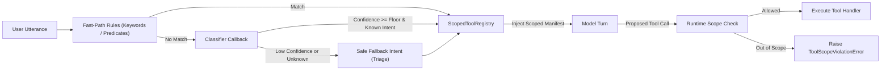

# Intent and Tool Routing

## 1. Problem & Failure Mode

Exposing an entire tool catalog to a single generalist prompt degrades production agent systems in three predictable ways:

1. **Schema Token Bloat and Selection Drift:** Injecting 25 to 60 JSON tool schemas into every turn consumes thousands of input tokens per step and lowers tool-choice accuracy when parameter names overlap across domains (for example, `get_account` in billing vs. `get_account` in identity).
2. **Uncalibrated RoutingGuesses:** Pure LLM routers forced to pick a specialist route without a minimum confidence floor silently guess on ambiguous prompts instead of routing to a safe clarification or triage handler.
3. **Prompt-Only Tool Filtering:** Filtering tool definitions only in the prompt leaves the execution dispatcher wide open. If an indirect prompt injection convinces the model to emit a tool call for a hidden administrative tool name (`rotate_api_key`), an unscoped executor runs it anyway.

## 2. When to Use vs. When NOT to Use

### Use When
- Your agent workspace spans distinct operational domains (billing, security, analytics, support) with separate read/write blast radii.
- Tool schemas exceed 8 to 10 functions or mix high-privilege mutations with public read queries.
- Deterministic prefixes, slash commands, or ticket IDs can resolve common intents in sub-millisecond time before falling back to a classifier.

### Do NOT Use When
- Your workflow is a fixed deterministic pipeline (for example, `parse -> validate -> insert`): write a regular function or cron job instead of an intent router.
- Your agent has 1 to 5 cohesive tools within a single domain and low ambiguity: a single tool-calling loop without a routing hop saves latency.

## 3. Control Flow (Mermaid Diagram)



## 4. Implementation Contract (Python & TypeScript)

Reference implementations live in [`python/agentic_patterns/coordination.py`](../../python/agentic_patterns/coordination.py) and [`typescript/src/coordination.ts`](../../typescript/src/coordination.ts).

### Python Reference Usage

```python
from agentic_patterns.coordination import (
    IntentRouter,
    RouteRule,
    ScopedToolRegistry,
    ToolSpec,
)

router = IntentRouter(
    rules=(
        RouteRule(intent="billing", keywords=("invoice", "refund"), priority=10),
        RouteRule(
            intent="security",
            predicate=lambda text: text.startswith("SEC-"),
            priority=20,
        ),
    ),
    classifier=lambda text: ("analytics", 0.88) if "cohort" in text.lower() else ("triage", 0.40),
    min_confidence=0.80,
    fallback_intent="triage",
    known_intents={"billing", "security", "analytics", "triage"},
)

registry = ScopedToolRegistry()
registry.register(
    ToolSpec(
        name="get_invoice",
        description="Read invoice details by ID",
        allowed_intents=frozenset({"billing"}),
        handler=lambda inv_id: {"invoice_id": inv_id, "status": "paid"},
        read_only=True,
    )
)
registry.register(
    ToolSpec(
        name="rotate_api_key",
        description="Rotate compromised service credentials",
        allowed_intents=frozenset({"security"}),
        handler=lambda key_id: {"rotated": key_id},
        read_only=False,
    )
)

decision = router.route("Please check my latest invoice")
manifest = registry.export_manifest(decision.intent)
result = registry.invoke(
    active_intent=decision.intent,
    tool_name="get_invoice",
    payload="INV-2048",
)
```

### TypeScript Reference Usage

```typescript
import {
  IntentRouter,
  ScopedToolRegistry,
} from "../../typescript/src/coordination.ts";

const router = new IntentRouter({
  rules: [
    { intent: "billing", keywords: ["invoice", "refund"], priority: 10 },
    { intent: "security", predicate: (t) => t.startsWith("SEC-"), priority: 20 },
  ],
  classifier: (text) =>
    text.toLowerCase().includes("cohort")
      ? { intent: "analytics", confidence: 0.88 }
      : { intent: "triage", confidence: 0.4 },
  minConfidence: 0.8,
  fallbackIntent: "triage",
  knownIntents: ["billing", "security", "analytics", "triage"],
});

const registry = new ScopedToolRegistry();
registry.register({
  name: "get_invoice",
  description: "Read invoice details by ID",
  allowedIntents: ["billing"],
  readOnly: true,
  handler: (invId: string) => ({ invoiceId: invId, status: "paid" }),
});

const decision = router.route("Please check my latest invoice");
const toolsForPrompt = registry.exportManifest(decision.intent);
const invoice = registry.invoke({
  activeIntent: decision.intent,
  toolName: "get_invoice",
  payload: "INV-2048",
});
```

### Framework Wiring Guidance
- **Google ADK:** Run `IntentRouter.route()` in a root coordinator `before_agent_callback` or entry router, then populate the active sub-agent's `tools` list from `registry.tools_for_intent(decision.intent)` and validate inside `before_tool_callback` via `registry.invoke()`.
- **LangGraph:** Model the router as an entry conditional edge (`add_conditional_edges("route", ...)`), bind only `export_manifest(intent)` tools to the specialist node's LLM, and wrap `ToolNode` execution with `registry.invoke()`.
- **Vercel AI SDK:** Dynamically construct the `tools` object passed to `generateText` / `streamText` using the scoped manifest for `decision.intent`, and keep `activeIntent` bound inside each tool's `execute` closure.
- **Raw SDK Loops:** Pass `export_manifest(decision.intent)` into the API `tools` array on each turn and dispatch model `tool_use` blocks exclusively through `registry.invoke()`.

## 5. Production Verification Checklist

When applying this skill to a codebase, write automated tests verifying:
- [ ] **Priority Ordering:** Higher-priority `RouteRule` predicates preempt lower-priority keyword matches when both match the same input.
- [ ] **Low-Confidence Fallback:** Classifier scores below `min_confidence` (and empty or whitespace-only inputs) deterministically route to `fallback_intent`.
- [ ] **Unknown Intent Rejection:** Classifier outputs naming an unregistered intent outside `known_intents` fall back safely rather than exposing an empty or crashed state.
- [ ] **Prompt-Time Filtering:** `export_manifest(intent)` omits tools belonging to sibling intents and respects `read_only_only=True` when in read-only mode.
- [ ] **Runtime Scope Enforcement:** Calling `invoke()` with a valid `tool_name` that is outside `active_intent` raises `ToolScopeViolationError` every time.
