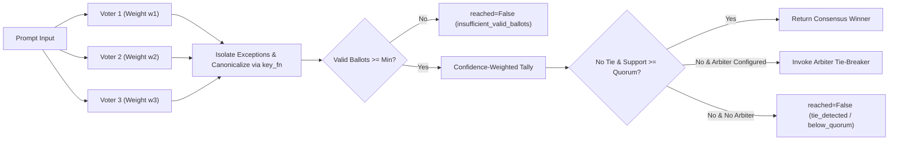

# Parallel Consensus Voting

## 1. Problem & Failure Mode

Relying on a single stochastic model generation (or naive `collections.Counter` majority vote) for high-impact decisions fails in three ways:

1. **Single-Sample Variance:** At non-zero temperature (or across subtle prompt phrasings), a single model call may misclassify an incident severity or compliance disposition 5% to 12% of the time.
2. **Naive Plurality Without Quorum or Confidence:** Simple plurality picks a "winner" on a `1-1-1` or `2-2` split (or treats a 0.51 guess identically to a 0.98 high-confidence classification), silently masking disagreement instead of escalating.
3. **All-or-Nothing Fan-Out Fragility:** Running 3 or 5 parallel voters with `Promise.all` / `asyncio.gather` without per-voter fault isolation crashes the entire decision whenever a single model endpoint times out.

## 2. When to Use vs. When NOT to Use

### Use When
- Decisions map to canonical discrete keys or normalized structured schemas (for example, incident severity `SEV1..SEV4`, fraud disposition, contract clause risk, root-cause bucket) where accuracy outweighs 3x token cost.
- Combining diverse prompts, temperatures, or model families reduces correlated errors.

### Do NOT Use When
- Open-ended long-form creative writing or code generation where outputs cannot be canonicalized via a deterministic `key_fn`: use [`independent-auditor-gate`](../independent-auditor-gate/SKILL.md) instead of voting.
- Routine low-risk steps on latency-critical interactive paths where 1x model inference already meets accuracy targets.

## 3. Control Flow (Mermaid Diagram)



## 4. Implementation Contract (Python & TypeScript)

Reference implementations live in [`python/agentic_patterns/resilience.py`](../../python/agentic_patterns/resilience.py) and [`typescript/src/resilience.ts`](../../typescript/src/resilience.ts).

### Python Reference Usage

```python
from agentic_patterns.resilience import (
    Ballot,
    ConsensusConfig,
    ParallelConsensus,
    VoterSpec,
)

consensus = ParallelConsensus(
    ConsensusConfig(
        quorum_ratio=0.66,
        min_valid_ballots=2,
        weight_by_confidence=True,
    )
)

voters = (
    VoterSpec("model_a", lambda doc: Ballot("model_a", "SEV2", confidence=0.92)),
    VoterSpec("model_b", lambda doc: Ballot("model_b", "SEV2", confidence=0.85)),
    VoterSpec("model_c", lambda doc: Ballot("model_c", "SEV3", confidence=0.55)),
)

result = consensus.decide(
    prompt_input="Checkout latency p99 spiked to 4.8s in us-east-1",
    voters=voters,
    key_fn=lambda label: label.strip().upper(),
    arbiter=lambda _inp, ballots: ballots[0].value,
)
assert result.reached and result.winner == "SEV2"
```

### TypeScript Reference Usage

```typescript
import { ParallelConsensus } from "../../typescript/src/resilience.ts";

const consensus = new ParallelConsensus({
  quorumRatio: 0.66,
  minValidBallots: 2,
  weightByConfidence: true,
});

const result = consensus.decide<string, string>({
  promptInput: "Checkout latency p99 spiked to 4.8s in us-east-1",
  keyFn: (label) => label.trim().toUpperCase(),
  voters: [
    { voterId: "model_a", fn: () => ({ voterId: "model_a", value: "SEV2", confidence: 0.92 }) },
    { voterId: "model_b", fn: () => ({ voterId: "model_b", value: "SEV2", confidence: 0.85 }) },
    { voterId: "model_c", fn: () => ({ voterId: "model_c", value: "SEV3", confidence: 0.55 }) },
  ],
});
```

### Framework Wiring Guidance
- **Google ADK:** Run candidate `LlmAgent` voters inside a `ParallelAgent` writing structured ballots to distinct state keys (`ballot_a`, `ballot_b`, `ballot_c`), followed by a deterministic reducer function calling `ParallelConsensus.decide()`.
- **LangGraph:** Fan out via `Send(...)` edges to parallel voter nodes and aggregate ballots in a join reducer node; if `result.reached` is `False`, route to [`tiered-human-escalation`](../tiered-human-escalation/SKILL.md).
- **Vercel AI SDK:** Execute `Promise.allSettled` across diverse provider/model `generateObject` calls, converting fulfilled results into `VoterSpec` ballots so a single provider hiccup degrades gracefully.
- **Raw SDK Loops:** Ensure voters are genuinely independent (vary system framing, rubric order, or model family); sampling the identical prompt at `temperature=0` three times produces 100% correlated errors for 3x the bill.

## 5. Production Verification Checklist

When applying this skill to a codebase, write automated tests verifying:
- [ ] **Fault Isolation:** One throwing voter out of three is recorded in `failed_voters` while the remaining valid ballots still achieve quorum.
- [ ] **Minimum Ballot Floor:** When valid ballots fall below `min_valid_ballots`, `decide()` returns `reached=False` and `reason == "insufficient_valid_ballots"`.
- [ ] **Tie & Below-Quorum Detection:** An exact `1-1` tie (or `40%/35%/25%` split below `quorum_ratio`) without an arbiter returns `reached=False` (`winner=None`) rather than picking arbitrarily.
- [ ] **Arbiter Provenance:** When an arbiter breaks a tie, `resolved_by_arbiter` is `True` so downstream audit logs distinguish consensus wins from tie-breaker overrides.
