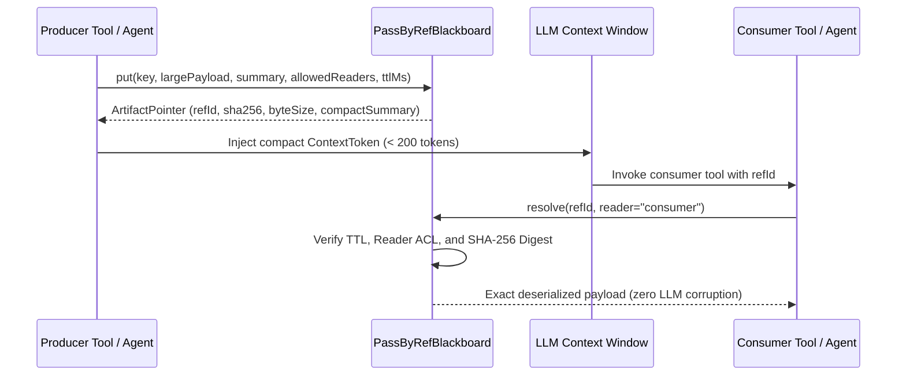

# Pass-by-Reference Blackboard

## 1. Problem & Failure Mode

Passing raw tool outputs inline through multi-turn or multi-agent message arrays causes three severe operational failures:

1. **Quadratic Context Explosion:** A 40KB SQL query result appended to turn 2 gets re-sent as prompt input on turns 3 through 15 across both supervisor and subagents, multiplying token spend and latency on every subsequent turn.
2. **Silent Re-Serialization Corruption:** Asking an LLM supervisor to copy a 500-row JSON array into a downstream charting or export tool introduces hallucinated edits, dropped rows, rounded floats, and broken escaping.
3. **Cross-Agent Data Leakage:** Shared scratchpads without reader ACLs allow untrusted formatting or external-facing subagents to read raw internal payloads they were never authorized to access.

## 2. When to Use vs. When NOT to Use

### Use When
- Tool outputs or intermediate artifacts routinely exceed 1KB to 2KB (database extracts, file contents, API pagination dumps, ASTs, binary/base64 blobs).
- Downstream deterministic tools need exact byte-for-byte fidelity from an upstream producer without the LLM re-typing the payload.
- Artifacts require reader-level access control (`allowed_readers`) and automatic TTL expiration.

### Do NOT Use When
- Payloads are tiny scalar values or short status structs (< 300 bytes) that the LLM directly reasons over in full: indirection adds an extra dereference step without saving tokens.
- A deterministic backend pipeline can pipe function A's return value directly into function B in code without involving an agent turn at all.

## 3. Control Flow (Mermaid Diagram)



## 4. Implementation Contract (Python & TypeScript)

Reference implementations live in [`python/agentic_patterns/coordination.py`](../../python/agentic_patterns/coordination.py) and [`typescript/src/coordination.ts`](../../typescript/src/coordination.ts).

### Python Reference Usage

```python
from agentic_patterns.coordination import PassByRefBlackboard

blackboard = PassByRefBlackboard(max_summary_chars=160)

# 1. Producer stores large payload out-of-band and returns compact pointer to LLM
pointer = blackboard.put(
    key="q3_churn_cohort",
    value=[{"account_id": i, "risk": 0.82} for i in range(1000)],
    kind="sql_rows",
    summary="1000 enterprise accounts scored for Q3 churn risk",
    producer="sql_worker",
    allowed_readers={"report_builder"},
    ttl_ms=300_000,
)

context_handle = pointer.to_context_token()

# 2. Authorized consumer tool dereferences exact payload by ref_id
rows = blackboard.resolve(pointer.ref_id, reader="report_builder")
```

### TypeScript Reference Usage

```typescript
import { PassByRefBlackboard } from "../../typescript/src/coordination.ts";

const blackboard = new PassByRefBlackboard({ maxSummaryChars: 160 });

const pointer = blackboard.put({
  key: "q3_churn_cohort",
  value: Array.from({ length: 1000 }, (_, i) => ({ accountId: i, risk: 0.82 })),
  kind: "sql_rows",
  summary: "1000 enterprise accounts scored for Q3 churn risk",
  producer: "sql_worker",
  allowedReaders: ["report_builder"],
  ttlMs: 300_000,
});

const contextHandle = pointer.toContextToken();
const rows = blackboard.resolve(pointer.refId, "report_builder");
```

### Framework Wiring Guidance
- **Google ADK:** Store large blobs in ADK's `ArtifactService` or `PassByRefBlackboard` backed by Redis/GCS, returning only `pointer.to_context_token()` from tool functions so session event history stays lean.
- **LangGraph:** Keep only `dict[str, ArtifactPointer]` handles inside LangGraph checkpointed state rather than raw DataFrames or document lists; tools dereference via a shared store injected through `RunnableConfig["configurable"]`.
- **Vercel AI SDK:** Use `toModelOutput` (or return `pointer.toContextToken()` from `tool.execute`) so the model sees only `refId` + `summary`, while downstream tools accept `refId: z.string()` and call `blackboard.resolve()`.
- **Raw SDK Loops:** Enforce a size guardrail on every tool response wrapper: if serialized tool output exceeds 2,048 bytes, automatically spill to `PassByRefBlackboard.put()` and return the pointer plus a short preview.

## 5. Production Verification Checklist

When applying this skill to a codebase, write automated tests verifying:
- [ ] **Summary Bound:** Summaries longer than `max_summary_chars` are deterministically truncated so large text never leaks into `to_context_token()`.
- [ ] **Exact Round-Trip Integrity:** Dereferencing `ref_id` returns a deep-equal copy of the original structure, and mutating the returned object does not mutate stored bytes.
- [ ] **Tamper Detection:** Corrupting backing storage bytes causes `resolve()` to raise `BlackboardIntegrityError` on SHA-256 mismatch.
- [ ] **Reader ACL Enforcement:** Calling `resolve()` with an agent identity outside `allowed_readers` (and not equal to `producer`) raises `BlackboardAccessError`.
- [ ] **TTL Expiry and Pruning:** Dereferencing past `ttl_ms` raises `BlackboardExpiredError`, and `prune_expired()` reclaims expired entries.
