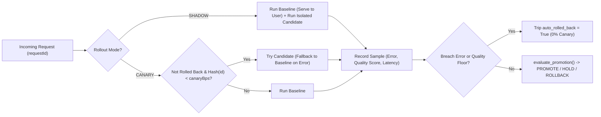

# Shadow and Canary Evaluation

## 1. Problem & Failure Mode

Deploying prompt edits, new model versions, or modified tool schemas directly to 100% of production traffic causes costly outages:

1. **Offline Eval Blind Spots:** Synthetic 50-row offline golden sets rarely capture real production edge cases (malformed user inputs, multi-turn state quirks, rare tool combinations).
2. **Candidate Crash Contamination:** Running experimental shadow code inline without strict exception isolation crashes the live user request when the candidate model hits a schema error or rate limit.
3. **Slow Manual Rollbacks:** Canary rollouts without automated rolling error-rate, quality-score, and p95-latency ratio gates continue serving broken responses to 10% of customers until an on-call engineer wakes up.

## 2. When to Use vs. When NOT to Use

### Use When
- Swapping underlying foundation models (for example, migrating a frontier model to a distilled flash model for cost reduction).
- Shipping major prompt, router, or retrieval pipeline changes in a live service with measurable SLOs (error rate, p95 latency ratio, automated rubric parity score).

### Do NOT Use When
- **Shadowing side-effecting mutations directly:** In `SHADOW` mode, the candidate must run against mocked/dry-run side-effect tools (or evaluate read/plan outputs prior to commit) so shadow traffic never double-charges cards or sends duplicate emails!
- Tiny internal scripts with no live user traffic: run your unit and offline evaluation suite directly in CI.

## 3. Control Flow (Mermaid Diagram)



## 4. Implementation Contract (Python & TypeScript)

Reference implementations live in [`python/agentic_patterns/resilience.py`](../../python/agentic_patterns/resilience.py) and [`typescript/src/resilience.ts`](../../typescript/src/resilience.ts).

### Python Reference Usage

```python
from agentic_patterns.resilience import (
    PromotionPolicy,
    RolloutMode,
    ShadowCanaryRunner,
)

runner = ShadowCanaryRunner(
    mode=RolloutMode.SHADOW,
    baseline=lambda prompt: {"route": "billing", "summary": prompt[:40]},
    candidate=lambda prompt: {"route": "billing", "summary": prompt[:40]},
    scorer=lambda _inp, base, cand: (
        1.0 if base is not None and base["route"] == cand["route"] else 0.0
    ),
    policy=PromotionPolicy(
        min_samples=50,
        max_candidate_error_rate=0.02,
        min_mean_quality_score=0.95,
        max_p95_latency_ratio=1.35,
    ),
)

res = runner.execute(request_id="req-9001", request_input="Invoice discrepancy")
assert res.served_variant == "baseline"

report = runner.evaluate_promotion()
# report.decision is PromotionDecision.HOLD_COLLECT_MORE until min_samples=50
```

### TypeScript Reference Usage

```typescript
import { ShadowCanaryRunner } from "../../typescript/src/resilience.ts";

interface AgentOutput {
  readonly route: string;
}

const runner = new ShadowCanaryRunner<string, AgentOutput>({
  mode: "CANARY",
  baseline: () => ({ route: "billing" }),
  candidate: () => ({ route: "billing" }),
  scorer: (_inp, base, cand) =>
    base === null || base.route === cand.route ? 1.0 : 0.0,
  policy: {
    canaryBps: 1_000, // 10% deterministic traffic slice
    minSamples: 50,
    maxCandidateErrorRate: 0.02,
    minMeanQualityScore: 0.95,
    maxP95LatencyRatio: 1.35,
  },
});

const out = runner.execute({
  requestId: "tenant-42:session-9",
  requestInput: "Invoice discrepancy",
});
const report = runner.evaluatePromotion();
```

### Framework Wiring Guidance
- **Google ADK:** Key `request_id` on `session_id` (not individual turn IDs) in `CANARY` mode so a multi-turn user conversation stays consistently pinned to either baseline or candidate across the entire session.
- **LangGraph:** Wrap compiled graph revisions (`graph_v1.invoke` vs. `graph_v2.invoke`) inside `ShadowCanaryRunner`; in `SHADOW` mode, inject read-only mock tool adapters into `graph_v2` via `RunnableConfig`.
- **Vercel AI SDK:** Dispatch shadow candidate `generateText` calls inside `after()` (Next.js) or `ctx.waitUntil()` (Cloudflare Workers / Vercel Edge) so candidate latency adds zero milliseconds to user time-to-first-token.
- **Raw SDK Loops:** Export `PromotionReport` metrics (`candidate_error_rate`, `mean_quality_score`, `p95_latency_ratio`, `auto_rolled_back`) to your deployment controller or feature-flag service.

## 5. Production Verification Checklist

When applying this skill to a codebase, write automated tests verifying:
- [ ] **Shadow Crash Isolation:** When `candidate` raises an exception in `SHADOW` mode, `execute()` still returns the valid `baseline` response and records `candidate_errored=True`.
- [ ] **Deterministic Sticky Bucketing:** Identical `request_id` strings always hash to the exact same basis-point bucket (`0..9999`) so multi-turn sessions do not flap between variants.
- [ ] **Canary Exception Fallback & Auto-Rollback:** Exceptions in `CANARY` mode transparently fall back to `baseline` for the active request and trip `auto_rolled_back=True` once `max_candidate_error_rate` is breached.
- [ ] **Sample Sufficiency Gate:** `evaluate_promotion()` returns `HOLD_COLLECT_MORE` (never `PROMOTE`) while `sample_count < min_samples`, and returns `ROLLBACK` if error rate, quality score, or `p95_latency_ratio` breaches policy.
