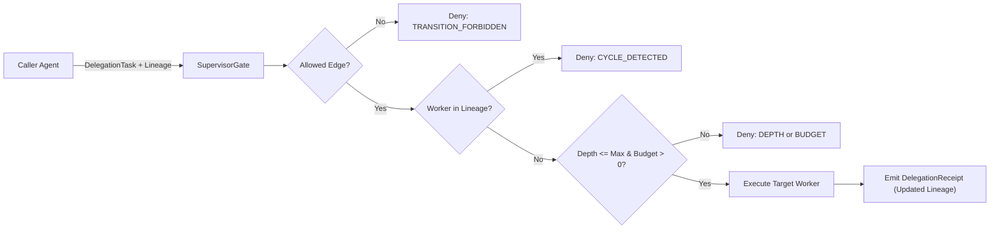

# Supervisor Delegation Gate

## 1. Problem & Failure Mode

Multi-agent handoff systems frequently fail under ambiguous or adversarial tasks when agents can delegate freely to one another:

1. **Ping-Pong Delegation Cycles:** A `researcher` agent lacks a required field and delegates back to `supervisor` or `planner`, which re-delegates the same subtask to `researcher`, looping until rate limits or context limits crash the worker.
2. **Unbounded Fan-Out and Depth:** Recursive subagents spawn child subagents without a shared call counter, multiplying single-request cost by 20x to 50x and blowing latency SLOs.
3. **Lateral Privilege Escalation:** A low-trust summarization subagent directly invokes a deployment or database-mutation subagent because handoff edges are not restricted by an explicit transition graph.

## 2. When to Use vs. When NOT to Use

### Use When
- Two or more specialized agents or subagents hand off tasks dynamically at runtime.
- Subagents require isolated context windows, distinct model tiers, or separate security credentials.
- You need deterministic upper bounds on per-request subagent invocations, recursion depth, and per-worker quotas.

### Do NOT Use When
- The execution order is known ahead of time (for example, `extract -> enrich -> format`): use a sequential function pipeline or DAG workflow rather than dynamic agent delegation.
- A single agent with 3 to 6 well-scoped tools can complete the task in one context window: adding a supervisor plus subagents increases latency, failure surface, and serialization loss for zero quality gain.

## 3. Control Flow (Mermaid Diagram)



## 4. Implementation Contract (Python & TypeScript)

Reference implementations live in [`python/agentic_patterns/coordination.py`](../../python/agentic_patterns/coordination.py) and [`typescript/src/coordination.ts`](../../typescript/src/coordination.ts).

### Python Reference Usage

```python
from agentic_patterns.coordination import (
    DelegationPolicy,
    DelegationTask,
    SupervisorGate,
)

policy = DelegationPolicy(
    allowed_transitions={
        "supervisor": frozenset({"researcher", "writer"}),
        "researcher": frozenset({"writer"}),
    },
    max_depth=2,
    max_total_delegations=4,
    max_calls_per_worker=2,
    prevent_cycles=True,
)

gate = SupervisorGate(policy)
gate.register_worker("researcher", lambda task: {"facts": [f"verified:{task.payload}"]})
gate.register_worker("writer", lambda task: f"Memo based on {task.payload}")

receipt = gate.delegate(
    DelegationTask(
        task_id="task-01",
        caller="supervisor",
        worker="researcher",
        objective="Collect primary metrics",
        payload="Q3-revenue",
    )
)
```

### TypeScript Reference Usage

```typescript
import { SupervisorGate } from "../../typescript/src/coordination.ts";

const gate = new SupervisorGate({
  allowedTransitions: {
    supervisor: ["researcher", "writer"],
    researcher: ["writer"],
  },
  maxDepth: 2,
  maxTotalDelegations: 4,
  maxCallsPerWorker: 2,
  preventCycles: true,
});

gate.registerWorker("researcher", (task) => ({
  facts: [`verified:${String(task.payload)}`],
}));
gate.registerWorker("writer", (task) => `Memo based on ${JSON.stringify(task.payload)}`);

const receipt = gate.delegate({
  taskId: "task-01",
  caller: "supervisor",
  worker: "researcher",
  objective: "Collect primary metrics",
  payload: "Q3-revenue",
});
```

### Framework Wiring Guidance
- **Google ADK:** Wrap `sub_agents` handoff tools in `SupervisorGate.delegate()`, storing `lineage` and `remaining_budget` in ADK `session.state` so nested subagents inherit the active call graph.
- **LangGraph:** Represent `lineage: tuple[str, ...]` and `delegation_count: int` as typed fields on `StateGraph` state; route every `Command(goto=...)` handoff through `SupervisorGate` before transitioning nodes.
- **Vercel AI SDK:** Expose subagent invocation as structured tools on the coordinator agent whose `execute` handlers call `gate.delegate()`, catching `DelegationDeniedError` to return a terminal instruction to synthesize with existing context.
- **Raw SDK Loops:** Instantiate one `SupervisorGate` per top-level request ID so budgets are strictly request-scoped and cannot leak across concurrent users.

## 5. Production Verification Checklist

When applying this skill to a codebase, write automated tests verifying:
- [ ] **Cycle Blocking:** A handoff chain `supervisor -> researcher -> supervisor` (or `A -> B -> C -> A`) immediately raises `DelegationDeniedError` with `reason == CYCLE_DETECTED`.
- [ ] **Transition Allowlist:** Any caller attempting to invoke a worker not listed in `allowed_transitions[caller]` fails with `TRANSITION_FORBIDDEN`.
- [ ] **Hard Depth Cap:** Passing a lineage exceeding `max_depth` fails with `MAX_DEPTH_EXCEEDED` before invoking the worker handler.
- [ ] **Global and Per-Worker Quotas:** Exhausting `max_total_delegations` raises `BUDGET_EXHAUSTED`, and exceeding `max_calls_per_worker` raises `WORKER_QUOTA_EXCEEDED`.
- [ ] **Pre-Invocation Accounting:** Counters increment prior to executing the target worker so recursive nested delegations observe accurate remaining budget.
