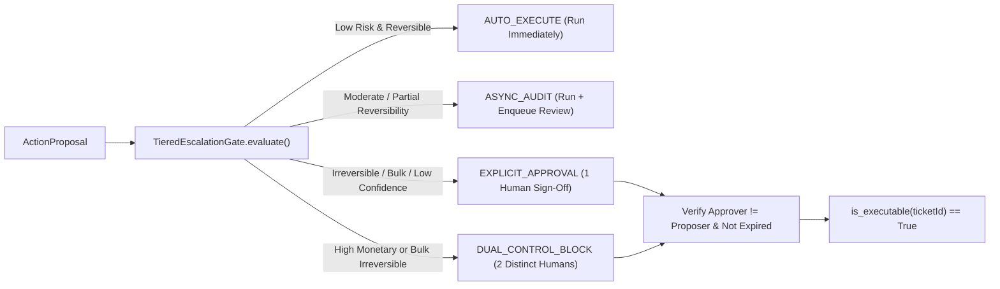

# Tiered Human Escalation

## 1. Problem & Failure Mode

Binary human-in-the-loop designs (interrupting a human on every tool call vs. running 100% autonomously) fail in enterprise operations:

1. **Approval Fatigue:** Prompting operators to click "Approve" 200 times a day on reversible $5 actions trains reviewers to rubber-stamp requests without reading parameters, missing the single destructive $25,000 action hidden in the queue.
2. **Self-Approval and Duplicate Sign-Off Loopholes:** Naive approval handlers verify `approvals >= 2` without verifying `approver != proposer` or `approver_1 != approver_2`, allowing a compromised identity or single operator to bypass dual control.
3. **Stale Zombie Approvals:** Approval tickets without hard TTL expiration (`expires_at_ms`) remain executable hours or days later after underlying system state has drifted.

## 2. When to Use vs. When NOT to Use

### Use When
- Agents execute actions across a spectrum of risk (for example, tagging tickets vs. issuing small credits vs. deleting infrastructure vs. wiring funds).
- High-blast-radius or irreversible operations require single or two-person (`DUAL_CONTROL_BLOCK`) sign-off with auditable reviewer identities.

### Do NOT Use When
- All agent operations are strictly read-only queries against non-sensitive data: enforce access via [`intent-and-tool-routing`](../intent-and-tool-routing/SKILL.md) instead of interrupting humans.
- Sub-10ms automated trading or real-time control loops where synchronous human pause is physically impossible: use hard pre-execution circuit bounds via [`constraint-anchoring`](../constraint-anchoring/SKILL.md).

## 3. Control Flow (Mermaid Diagram)



## 4. Implementation Contract (Python & TypeScript)

Reference implementations live in [`python/agentic_patterns/resilience.py`](../../python/agentic_patterns/resilience.py) and [`typescript/src/resilience.ts`](../../typescript/src/resilience.ts).

### Python Reference Usage

```python
from agentic_patterns.resilience import (
    ActionProposal,
    EscalationPolicy,
    Reversibility,
    TieredEscalationGate,
)

gate = TieredEscalationGate(
    policy=EscalationPolicy(
        auto_max_monetary=50.0,
        async_audit_max_monetary=500.0,
        dual_control_monetary=5_000.0,
        bulk_record_threshold=100,
        min_auto_confidence=0.85,
        ticket_ttl_ms=900_000,
    )
)

decision = gate.evaluate(
    ActionProposal(
        proposal_id="prop-77",
        proposer="treasury_agent",
        action_name="Settle vendor invoice batch",
        reversibility=Reversibility.IRREVERSIBLE,
        monetary_impact=12_500.0,
        affected_records=14,
        confidence=0.96,
    )
)

assert not decision.can_execute_now and decision.ticket is not None
tkt_id = decision.ticket.ticket_id

gate.approve(tkt_id, approver="controller_1@corp.example")
gate.approve(tkt_id, approver="controller_2@corp.example")
assert gate.is_executable(tkt_id)
```

### TypeScript Reference Usage

```typescript
import { TieredEscalationGate } from "../../typescript/src/resilience.ts";

const gate = new TieredEscalationGate({
  policy: {
    autoMaxMonetary: 50,
    asyncAuditMaxMonetary: 500,
    dualControlMonetary: 5_000,
    bulkRecordThreshold: 100,
    minAutoConfidence: 0.85,
    ticketTtlMs: 900_000,
  },
});

const decision = gate.evaluate({
  proposalId: "prop-77",
  proposer: "treasury_agent",
  actionName: "Settle vendor invoice batch",
  reversibility: "IRREVERSIBLE",
  monetaryImpact: 12_500,
  affectedRecords: 14,
  confidence: 0.96,
});

if (!decision.canExecuteNow && decision.ticket) {
  gate.approve(decision.ticket.ticketId, "controller_1@corp.example");
  gate.approve(decision.ticket.ticketId, "controller_2@corp.example");
  const ready = gate.isExecutable(decision.ticket.ticketId);
}
```

### Framework Wiring Guidance
- **Google ADK:** Use ADK's `ToolConfirmation` / long-running tool pause mechanism when `decision.can_execute_now` is `False`, persisting `decision.ticket` in your approval database and resuming only when `gate.is_executable(ticket_id)` returns `True`.
- **LangGraph:** Trigger `interrupt({"ticket": decision.ticket, "reasons": decision.reasons})` inside the pre-execution gate node whenever `tier` is `EXPLICIT_APPROVAL` or `DUAL_CONTROL_BLOCK`, resuming via `Command(resume=...)` after authenticated sign-off.
- **Vercel AI SDK:** Omit `execute` on high-risk client-confirmable tools (or return a pending ticket status object rendered as an approval card UI), executing the server action only after authenticated session verification passes `gate.approve()`.
- **Raw SDK Loops:** Record every `ApprovalTicket` creation and sign-off event into [`causal-audit-ledger`](../causal-audit-ledger/SKILL.md) as a required parent ID of the subsequent mutation event.

## 5. Production Verification Checklist

When applying this skill to a codebase, write automated tests verifying:
- [ ] **Four-Tier Routing Accuracy:** Boundary inputs deterministically classify across `AUTO_EXECUTE`, `ASYNC_AUDIT`, `EXPLICIT_APPROVAL`, and `DUAL_CONTROL_BLOCK`.
- [ ] **Async Audit Queueing:** `ASYNC_AUDIT` actions return `can_execute_now=True` AND append the proposal to `async_audit_queue`.
- [ ] **Self-Approval Prevention:** Calling `approve()` where `approver == proposal.proposer` (or blank) raises `EscalationError`.
- [ ] **Distinct Dual-Control Signers:** A single human calling `approve()` twice on a `DUAL_CONTROL_BLOCK` ticket raises `EscalationError` and leaves `is_executable()` as `False`.
- [ ] **Ticket Expiration & Rejection:** Tickets past `expires_at_ms` or marked via `reject()` return `is_executable() == False` and reject subsequent `approve()` attempts.
