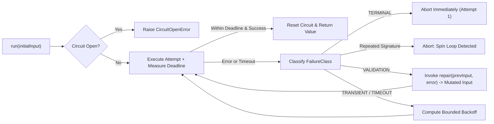

# Watchdog Adaptive Retry

## 1. Problem & Failure Mode

Standard `tenacity` or naive `for attempt in range(5): sleep(2**attempt)` loops fail in agentic workloads for three reasons:

1. **Blind Retries on Deterministic Schema Errors:** If an agent passes `page_size=500` to an API whose maximum is `100`, retrying the exact same payload 4 times with exponential backoff wastes 15 seconds and fails 100% of the time unless a `repair` hook mutates the input.
2. **Spin Loops on Identical Errors:** Even with a repair prompt, an agent may emit the exact same broken query twice in a row; continuing after an identical consecutive failure signature burns tokens for zero progress.
3. **Missing Deadlines and Circuit Breakers:** Hung upstream tool servers block worker threads indefinitely without per-attempt deadlines, and continuing to hammer a down dependency cascades latency across all concurrent agent runs.

## 2. When to Use vs. When NOT to Use

### Use When
- Calling external tools, MCP servers, database sandboxes, or structured-output model endpoints that can fail with a mix of transient `503`/`429` errors, repairable `400` validation errors, timeouts, and permanent `401`/`403` errors.
- You need strict separation between backoff-only retries (`TRANSIENT`, `TIMEOUT`), input-mutating retries (`VALIDATION`), and zero-retry immediate aborts (`TERMINAL`).

### Do NOT Use When
- Calling pure in-memory deterministic helper functions that cannot transiently fail: let programming bugs raise immediately.
- Wrapping non-idempotent mutations *without* pairing with [`idempotent-checkpointing`](../idempotent-checkpointing/SKILL.md): retrying a timed-out non-idempotent POST can double-write if the first attempt succeeded server-side.

## 3. Control Flow (Mermaid Diagram)



## 4. Implementation Contract (Python & TypeScript)

Reference implementations live in [`python/agentic_patterns/resilience.py`](../../python/agentic_patterns/resilience.py) and [`typescript/src/resilience.ts`](../../typescript/src/resilience.ts).

### Python Reference Usage

```python
import asyncio
from agentic_patterns.resilience import RetryPolicy, WatchdogRetryRunner

runner = WatchdogRetryRunner(
    policy=RetryPolicy(
        max_attempts=3,
        timeout_ms=2_500,
        base_backoff_ms=10,
        max_backoff_ms=100,
        circuit_failure_threshold=5,
        circuit_cooldown_ms=30_000,
    )
)


def query_api(params: dict[str, int], _attempt: int) -> list[int]:
    if params["limit"] > 100:
        raise ValueError("limit must be <= 100")
    return list(range(params["limit"]))


outcome = runner.run(
    initial_input={"limit": 500},
    operation=query_api,
    repair=lambda prev, err, _att: {"limit": 100} if "100" in err else prev,
)
assert outcome.succeeded and len(outcome.value or []) == 100


async def query_api_async(params: dict[str, int], _attempt: int) -> list[int]:
    await asyncio.sleep(0.001)
    if params["limit"] > 100:
        raise ValueError("limit must be <= 100")
    return list(range(params["limit"]))


async_outcome = asyncio.run(
    runner.run_async(
        initial_input={"limit": 500},
        operation=query_api_async,
        repair=lambda prev, err, _att: {"limit": 100} if "100" in err else prev,
    )
)
assert async_outcome.succeeded and len(async_outcome.value or []) == 100
```

### TypeScript Reference Usage

```typescript
import { WatchdogRetryRunner } from "../../typescript/src/resilience.ts";

const runner = new WatchdogRetryRunner({
  policy: {
    maxAttempts: 3,
    timeoutMs: 2_500,
    baseBackoffMs: 10,
    maxBackoffMs: 100,
    circuitFailureThreshold: 5,
    circuitCooldownMs: 30_000,
  },
});

const syncOutcome = runner.run<{ readonly limit: number }, number[]>({
  initialInput: { limit: 500 },
  operation: (params) => {
    if (params.limit > 100) {
      throw new RangeError("limit must be <= 100");
    }
    return Array.from({ length: params.limit }, (_, i) => i);
  },
  repair: (prev, err) => (err.includes("100") ? { limit: 100 } : prev),
});

const asyncOutcome = await runner.runAsync<{ readonly limit: number }, number[]>({
  initialInput: { limit: 500 },
  operation: async (params, _attempt, signal) => {
    if (signal.aborted) {
      throw new Error("aborted");
    }
    if (params.limit > 100) {
      throw new RangeError("limit must be <= 100");
    }
    return Array.from({ length: params.limit }, (_, i) => i);
  },
  repair: (prev, err) => (err.includes("100") ? { limit: 100 } : prev),
});
```

### Framework Wiring Guidance
- **Google ADK:** Share one `WatchdogRetryRunner` instance per downstream dependency (for example, `crm_runner`, `warehouse_runner`) so circuit-breaker state protects across concurrent sessions, and wire `on_tool_error_callback` to feed structured validation hints into `repair`.
- **LangGraph:** Wrap flaky external nodes in `WatchdogRetryRunner` rather than relying on undifferentiated graph-level `RetryPolicy`, ensuring `PermissionError` (`TERMINAL`) fails in 1 attempt instead of 3.
- **Vercel AI SDK:** Pass `AbortSignal.timeout(timeoutMs)` into `generateText` / `fetch` alongside `WatchdogRetryRunner` so hung network sockets are cancelled promptly when the watchdog deadline trips.
- **Raw SDK Loops:** Log `outcome.attempts` into telemetry to track validation repair rates (high repair rates indicate ambiguous tool parameter descriptions that should be fixed at the schema level).

## 5. Production Verification Checklist

When applying this skill to a codebase, write automated tests verifying:
- [ ] **Zero-Retry Terminal Fast Fail:** `PermissionError` / `TERMINAL` errors stop on attempt 1 with `aborted_reason == "terminal_failure"`.
- [ ] **Adaptive Validation Repair:** `VALIDATION` errors invoke `repair()` to mutate parameters and succeed on attempt 2, whereas `VALIDATION` errors *without* a `repair` hook abort immediately (`unrepairable_validation_failure`).
- [ ] **Spin-Loop Detection:** Identical consecutive failure signatures without input repair abort early with `repeated_failure_signature`.
- [ ] **Watchdog Deadline Enforcement:** Operations exceeding `timeout_ms` classify as `TIMEOUT` even if they return a late value.
- [ ] **Circuit Breaker Trip and Recovery:** Reaching `circuit_failure_threshold` opens the circuit (`CircuitOpenError`), and advancing past `circuit_cooldown_ms` allows recovery probes.
